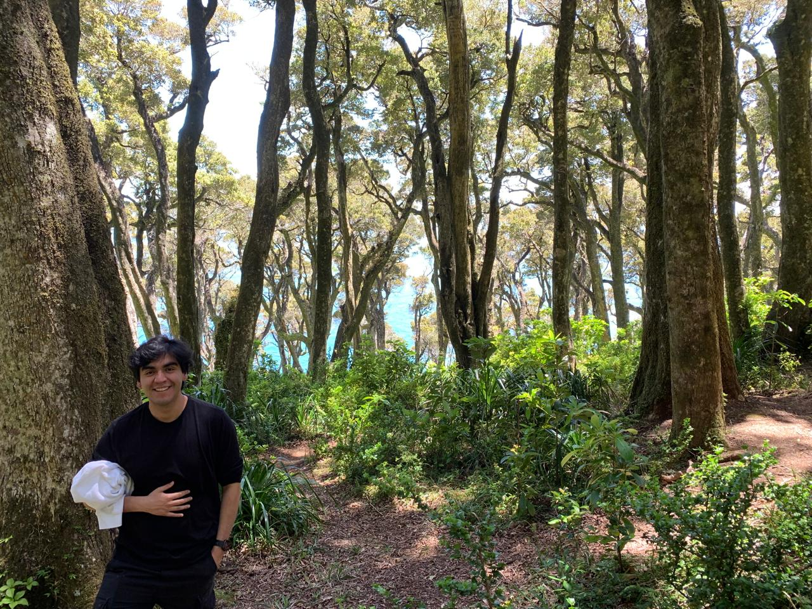

# Felipe Labra Irribarra

<!--  -->

I'm a PhD student at the Universidad de Sevilla, Spain, advised by [Anna Doubova](https://personal.us.es/doubova/) and [Enrique Fernández-Cara](https://scholar.google.com/citations?user=cMKza3UAAAAJ&hl=es). Previously, I completed a Master’s degree in Mathematics at Pontificia Universidad Católica de Chile under the supervision of [Eduardo Cerpa](https://www.mat.uc.cl/~eduardo.cerpa/), and a professional degree in Mathematical Engineering at Universidad Técnica Federico Santa María under the supervision of [Patricio Guzmán](http://pguzman.mat.utfsm.cl/) and [Hugo Parada](https://sites.google.com/view/hugo-parada).

## Research interests

Partial Differential Equations, Microlocal Analysis, Control Theory, Inverse Problems and Stabilization of PDEs.

#### Contact: fellabirr-at-alum.us.es, flabrai-at-estudiante.uc.cl, fnlabrairribarra-at-gmail.com
